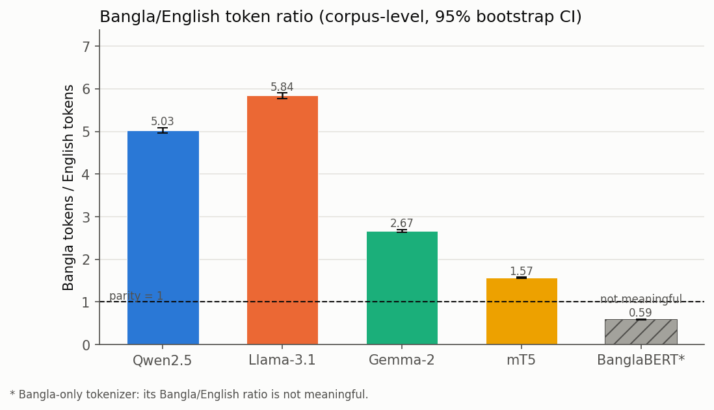
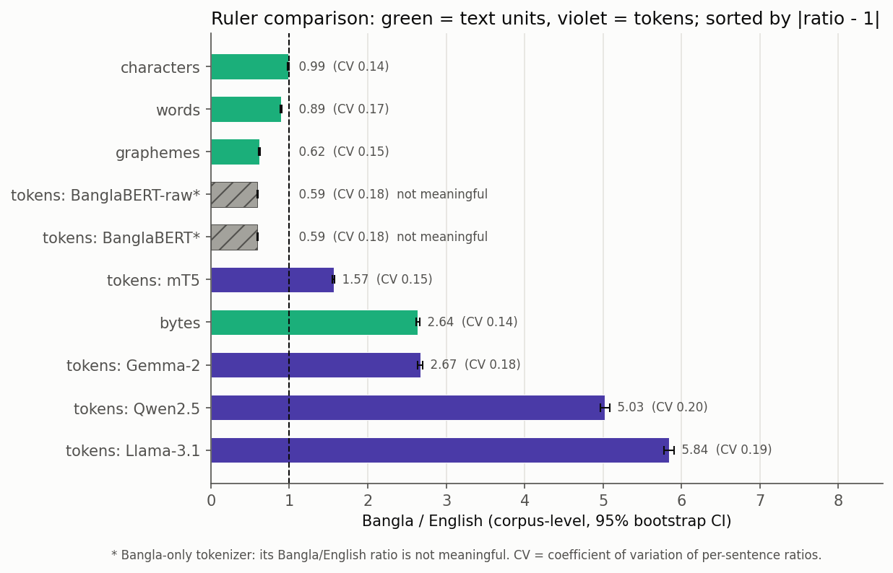

# How many tokens does Bangla cost across LLMs?

A small, pre-registered measurement study. Positional methods such as RoPE and ALiBi count distance in **tokens**. If Bangla needs many more tokens than English for the same meaning, the same real distance looks longer in Bangla, and less Bangla text fits in a context window. This repository measures that gap on FLORES-200 and asks which unit of measurement (the "ruler") is fairest across the two languages.



## Key findings

On FLORES-200 devtest (1,012 English–Bangla sentence pairs):

- **Bangla needs 2.7–5.8× as many tokens as English** for the same content in current LLM tokenizers.

  | Tokenizer | Tokens/word (EN) | Tokens/word (BN) | BN/EN token ratio [95% CI] |
  |---|---|---|---|
  | Llama 3.1 | 1.24 | 8.14 | **5.84** [5.78, 5.91] |
  | Qwen 2.5 | 1.26 | 7.12 | **5.03** [4.97, 5.09] |
  | Gemma 2 | 1.23 | 3.70 | **2.67** [2.64, 2.70] |
  | mT5 | 1.54 | 2.72 | **1.57** [1.55, 1.58] |
  | BanglaBERT* | 2.08 | 1.38 | 0.59 (not meaningful) |

  \* BanglaBERT is a Bangla-only tokenizer. It is reported as a best-case reference for Bangla, but its Bangla/English ratio is not meaningful.

- **Most of the context window is lost.** At a 128k-token window, Llama 3.1 holds as much Bangla content as about 22k tokens of English (**83% lost**), and Qwen 2.5 about 26k (80% lost). Gemma 2's native 8k window fits 303 English sentences but only 104 Bangla ones.
- **Llama and Qwen often split single Bangla letters.** 85% (Llama) and 68% (Qwen) of Bangla tokens are byte fragments that don't form a complete character on their own.
- **Characters are almost language-neutral.** Measured in Unicode characters, the Bangla/English ratio is **0.988** [0.980, 0.996], with the lowest variation across sentences of any ruler (CV 0.140). Every multilingual tokenizer is far from parity. This motivates measuring position in characters rather than tokens.



| Ruler | BN/EN ratio [95% CI] | CV across sentences |
|---|---|---|
| characters | **0.988** [0.980, 0.996] | 0.140 |
| words (whitespace) | 0.891 [0.882, 0.900] | 0.173 |
| grapheme clusters | 0.619 [0.614, 0.624] | 0.149 |
| UTF-8 bytes | 2.640 [2.618, 2.662] | 0.141 |
| mT5 tokens | 1.567 [1.553, 1.581] | 0.152 |
| Gemma 2 tokens | 2.670 [2.640, 2.699] | 0.184 |
| Qwen 2.5 tokens | 5.026 [4.965, 5.086] | 0.198 |
| Llama 3.1 tokens | 5.841 [5.775, 5.907] | 0.191 |

## Pre-registered hypotheses

These were written down before any results were computed (first cell of the notebook):

| | Hypothesis | Result |
|---|---|---|
| H1 | Llama 3.1, Qwen 2.5 and Gemma 2 each have a Bangla/English token ratio > 1.5 | **PASS** |
| H2 | BanglaBERT has the lowest Bangla fertility of the five tokenizers | **PASS** |
| H3 | Characters or graphemes give a ratio closer to 1 than any tokenizer's tokens | **PASS** |
| Rule | If all three modern LLMs have ratios < 1.3, the position-encoding motivation is weak | **Not triggered** |

## Repository contents

```
├── bangla_token_tax.ipynb     # the full study; runs top to bottom on Kaggle
├── src/
│   ├── bangla_token_tax.py    # notebook source (percent format)
│   └── build_notebook.py      # regenerates the .ipynb from the source
└── results/
    ├── results_main.csv       # one row per tokenizer: fertility, ratio, CI, metadata
    ├── ruler_comparison.csv   # every ruler: ratio, CI, coefficient of variation
    ├── effective_context.csv  # English-equivalent window and sentences that fit, per window size
    ├── per_sentence.csv       # every count for every sentence
    ├── example_tokenizations.csv
    ├── diagnostics.json       # UNK, partial-character, round-trip, Bengali vocab counts
    ├── run_info.json          # versions, data source, tokenizer commit hashes
    ├── summary.md             # all tables in one file
    └── figures/               # 5 PNG figures
```

## Method

- **Data:** FLORES-200 devtest, `eng_Latn` and `ben_Beng`, 1,012 aligned sentences, Unicode NFC-normalized. Alignment is checked automatically.
- **Tokenizers:** Qwen 2.5 (`Qwen/Qwen2.5-7B`), Llama 3.1 (`meta-llama/Llama-3.1-8B`), Gemma 2 (`google/gemma-2-9b`), mT5 (`google/mt5-base`), BanglaBERT (`csebuetnlp/banglabert`), each pinned to a commit hash (see `results/run_info.json`). Only tokenizers and configs are downloaded, never model weights. Special tokens are excluded.
- **Rulers:** whitespace words, Unicode code points, grapheme clusters (`\X`), UTF-8 bytes, and tokens from each tokenizer.
- **Statistics:** corpus-level ratio (sum of Bangla units / sum of English units) with a 95% paired bootstrap CI (10,000 resamples, seed 0, same resamples for every ruler), plus per-sentence median, IQR and coefficient of variation.
- **Effective context:** English-equivalent window = W / ratio for W = 512 to 131,072 and each model's native window.

## Reproduce it

1. Import `bangla_token_tax.ipynb` into Kaggle (**File → Import Notebook**).
2. Settings: Accelerator **None**, Internet **On**.
3. **Add-ons → Secrets:** add a Hugging Face read token as `HF_TOKEN` and tick it for this notebook. Accept the licences for `meta-llama/Llama-3.1-8B` and `google/gemma-2-9b` on Hugging Face first. Without a token, the notebook falls back to the `unsloth/` mirrors. Their vocabularies were verified to be identical to the official ones.
4. **Save & Run All.** It takes about 1–5 minutes on CPU. Outputs go to `/kaggle/working/`.

Results were identical with transformers 4.46.3 (Python 3.11) and 5.16.1 (Python 3.13).

## Caveats

- **NFC normalization** splits the precomposed letters য়, ড় and ঢ় into a base letter plus nukta, because they are Unicode composition exclusions. This affects 609 Bangla sentences and adds about 1% more characters.
- **Formatting quirks in the original FLORES-200 Bangla file.** 67 lines are wrapped in spreadsheet-style quotes and 71 contain double spaces. The effect on the ratios is well under 1%.
- **"Sentences that fit" is approximate.** It adds per-sentence token counts rather than tokenizing one concatenated text.
- **One corpus.** FLORES is Wikipedia-style text, so other domains may differ.

## Related work

This study updates earlier measurements of cross-lingual tokenization disparity to current tokenizers and adds the ruler comparison. In particular:

- Petrov, La Malfa, Torr & Bibi (2023). *Language Model Tokenizers Introduce Unfairness Between Languages.* NeurIPS 2023.

## Data and citations

- **FLORES-200:** NLLB Team et al. (2022). *No Language Left Behind: Scaling Human-Centered Machine Translation.* Goyal et al. (2022). *The FLORES-101 Evaluation Benchmark for Low-Resource and Multilingual Machine Translation.* TACL. FLORES-200 is licensed under **CC BY-SA 4.0**. `results/per_sentence.csv` and `results/example_tokenizations.csv` contain FLORES sentences and are shared under the same licence.
- **BanglaBERT:** Bhattacharjee et al. (2022). *BanglaBERT: Language Model Pretraining and Benchmarks for Low-Resource Language Understanding Evaluation in Bangla.* Findings of NAACL 2022. Text normalized with the [csebuetnlp normalizer](https://github.com/csebuetnlp/normalizer) as its model card recommends.

## License

Code: MIT (see `LICENSE`). Data excerpts in `results/`: CC BY-SA 4.0, following FLORES-200.
